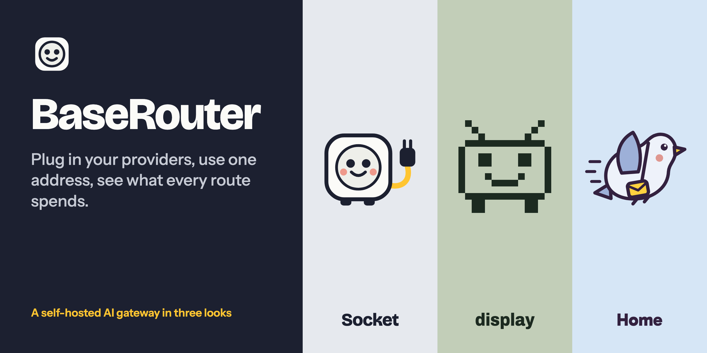
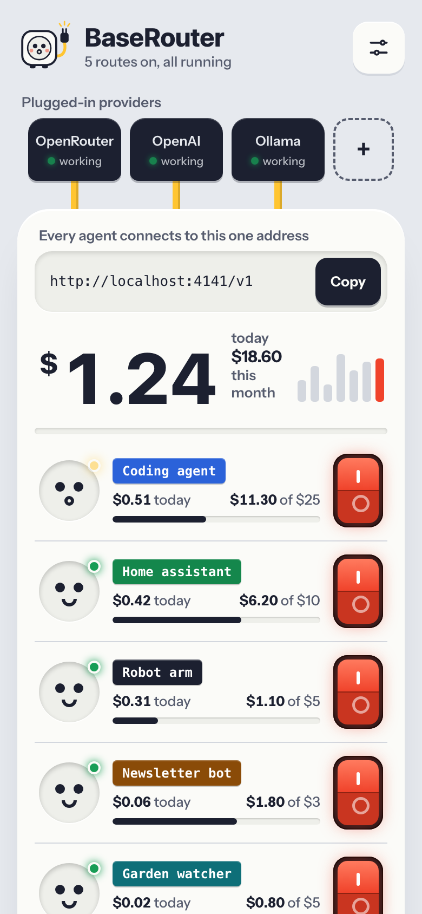
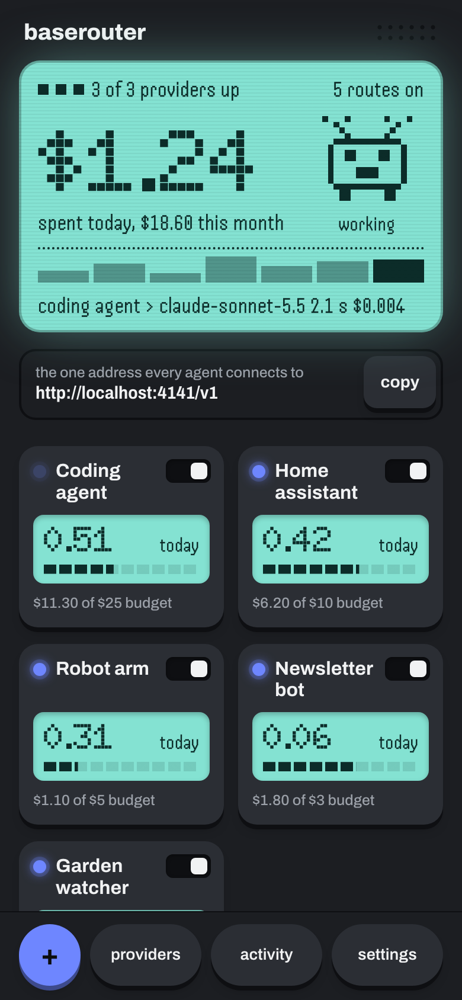
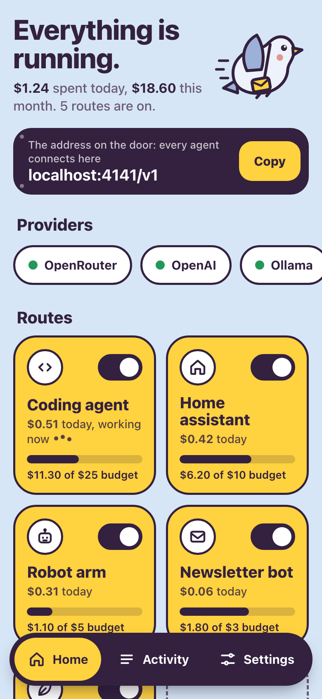

#  BaseRouter



BaseRouter is a self-hosted AI gateway with the simplicity of a smart-home panel. You add your provider keys once, every agent and app talks to one OpenAI-compatible address, and a small friendly panel shows what each of them costs. See [PRODUCT.md](PRODUCT.md) for what it is and who it is for.

It comes in three looks. They share everything underneath; pick the one you like, or [draw your own](design/prototype/README.md).

| Socket | Display | Home |
|---|---|---|
|  |  |  |

## Status

The design is done and the gateway has its first slice: one provider (OpenRouter), the one address, budgets and a record of every request. The panel is still a clickable prototype on made-up data; it is not wired to the gateway yet. The design rules and the three skins are described in [DESIGN.md](DESIGN.md).

- `gateway/` — the gateway. See [its README](gateway/README.md) for how to run it.
- `design/prototype/` — the home screen in three skins (Socket, Display, Home) running on one shared state. See [its README](design/prototype/README.md) for how skins work and how to add one.
- `design/directions/` — the first three stand-alone mock-ups the skins grew out of.

To run the gateway:

```bash
cd gateway && bun install && bun start
```

To run the prototype:

```bash
bun design/serve.ts
```

Then open http://127.0.0.1:4173/. The bar at the top switches skin, language (English, Turkish) and theme. `/prototype/check.html` shows every skin in every state.

The images above are made with `sh design/screenshots/make.sh` while that server is running.

## Licence

[MIT](LICENSE)
